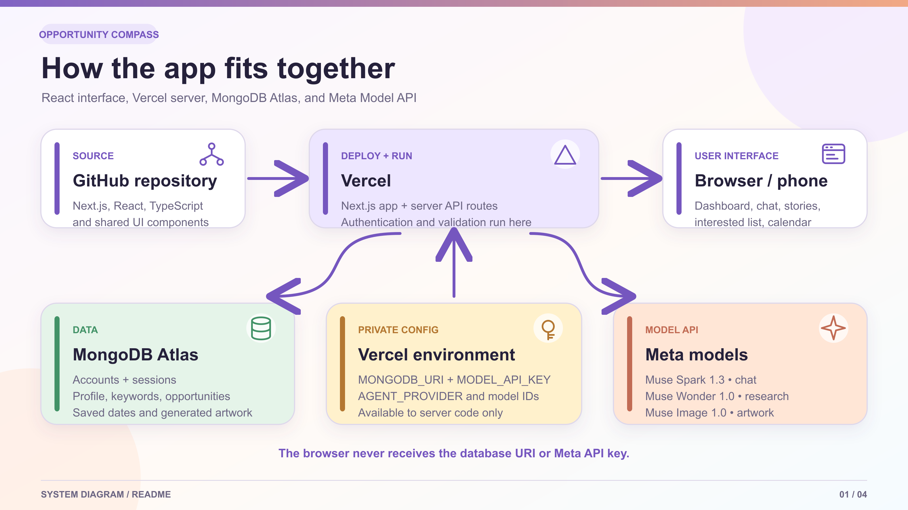
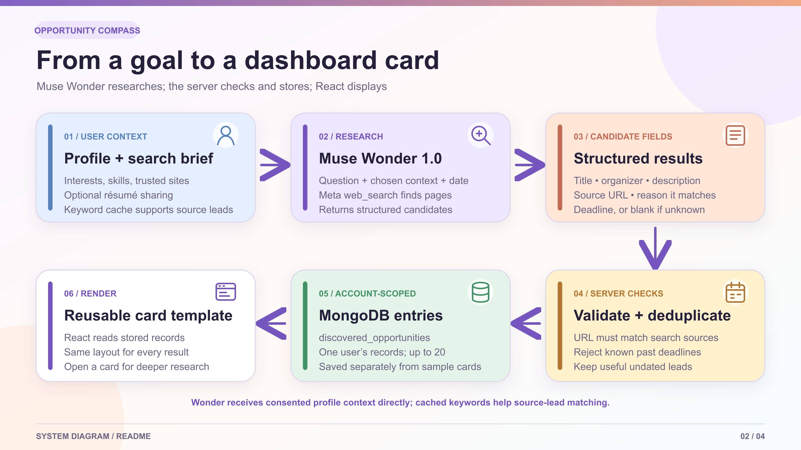
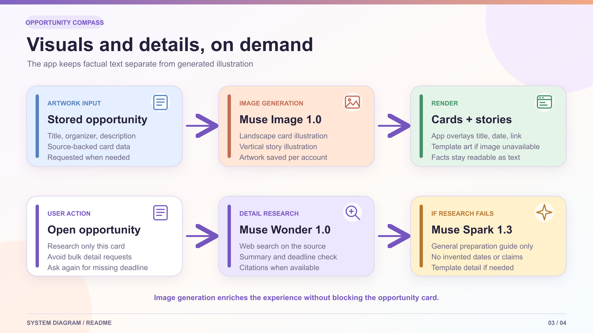
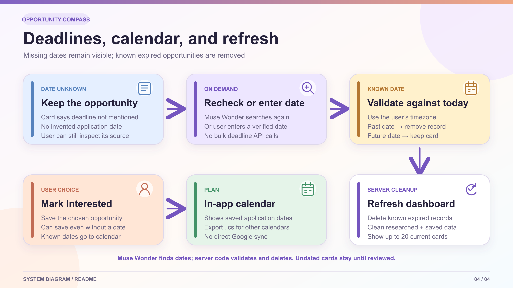

# Opportunity Compass

**Find the opportunity before you see someone else's winning post.**

Hackathons, competitions, fellowships, events, and jobs appear across different websites and social posts. Opportunity Compass lets a person describe what they want, researches relevant opportunities on the web, and organizes the results in a private dashboard. Users can inspect a source, save an opportunity, and track a known application deadline in an in-app calendar.

The app is a responsive **Next.js, React, and TypeScript** project deployed on **Vercel**, with **MongoDB Atlas** for accounts and user-scoped data. It uses **Meta Model API** for conversation, web research, and opportunity artwork. Muse Code helped develop and refine the application.

**Try the deployed app:** [Opportunity Compass on Vercel](https://opportunity-compass-rust.vercel.app/). Open the link to create an account or sign in; the dashboard is personalized after login. To run it locally, see [Run locally](#run-locally).

## What a user can do

1. **Create an account** and enter interests, skills, experience, location, and an optional PDF or text résumé.
2. **Write a search brief** with goals and preferred websites. Profile and résumé sharing with Meta are separate choices.
3. **Ask in chat** for something specific, such as “remote AI hackathons” or “essay-writing competitions in tech.” A discovery request can add researched cards to the dashboard.
4. **Explore a card** for its source, a more detailed Muse Wonder research attempt, and a deadline recheck when the date was not published initially.
5. **Mark Interested.** A card can be saved without a deadline; a known application deadline also appears in the in-app calendar and can be exported as an `.ics` file.
6. **View stories** for a quick, phone-friendly look. Update status requests Muse Image artwork for up to four opportunities at a time; the viewer can show all current dashboard opportunities with labelled template art until generated art is ready.

Users can also save an Instagram post, LinkedIn post, or ordinary public URL with a caption in **Shared links**. A saved link is an unverified lead for later research; pasting it does not automatically create a dashboard card or train a model.

## Architecture



| Layer       | Technology                      | Responsibility                                                                                                              |
| ----------- | ------------------------------- | --------------------------------------------------------------------------------------------------------------------------- |
| Interface   | Next.js, React, TypeScript, CSS | Responsive dashboard, chat, opportunity cards, stories, profile, Interested list, and calendar                              |
| Server      | Next.js API routes on Vercel    | Authentication, model requests, source and date checks, rate limits, MongoDB access, and private image delivery             |
| Data        | MongoDB Atlas                   | Accounts, sessions, profile, résumé, preferences, chat, leads, researched opportunities, saved items, and generated artwork |
| AI          | Meta Model API                  | Muse Spark 1.3 for conversation and supporting text, Muse Wonder 1.0 for research, Muse Image 1.0 for artwork               |
| Development | Muse Code                       | Coding assistance during implementation                                                                                     |

The browser calls the app's server routes. **The Meta models do not connect to MongoDB or write dashboard HTML.** Server code decides which model to call, validates its output, stores accepted records for the authenticated user, and returns data that React renders with reusable components. `MONGODB_URI` and `MODEL_API_KEY` belong in server-side Vercel environment variables, never in browser code or this repository.

## How discovery works



For a discovery request, the server combines the user's latest question with the **current date in their chosen timezone** and the context they have opted to share. That context can include their profile, search brief, preferred source sites, recent conversation, saved leads, and separately authorized résumé. A user's latest request and saved brief define the target; older chat topics are not treated as permanent interests.

When `META_DISCOVERY_MODEL=muse-wonder-1.0` is configured, the request asks **Muse Wonder** to use Meta's `web_search` tool. Each request limits web-search calls to six and asks for up to eight structured candidates with a title, organizer, description, source URL, reason for relevance, and a `YYYY-MM-DD` application deadline or an empty value if the date is unknown. If the model stops before producing a final summary, cited search results can still become unverified leads. The server then:

- checks required fields and that a returned URL matches the search sources;
- rejects malformed or known past deadlines and avoids duplicate opportunities;
- saves accepted results under the signed-in user's ID in `discovered_opportunities`;
- retains useful undated leads but labels their date and eligibility as unverified; and
- keeps the researched collection capped at 20 records per user, then renders the current dashboard through one card template.

**Keyword cache detail:** during discovery, the app may ask Muse Spark to extract search phrases from consented profile information and stores them in `profile_keywords`. The cache is refreshed when its profile/brief signature changes. It currently helps select additional leads from search sources; Muse Wonder receives the consented profile and brief directly. Saving a profile does not itself run a discovery search.

If Wonder is unavailable during configured discovery, the app can retry with Muse Spark. The model can still return incomplete or mistaken information: each card links back to a source, and users should confirm eligibility and deadlines on the official page before applying. Search is **not exhaustive** across the whole web.

## What each Meta model does

| Model       | Model ID          | Use in Opportunity Compass                                                                                     |
| ----------- | ----------------- | -------------------------------------------------------------------------------------------------------------- |
| Muse Spark  | `muse-spark-1.3`  | General chat, Quick Look topics, optional keyword extraction, and fallback discovery or general card summaries |
| Muse Wonder | `muse-wonder-1.0` | Web-backed opportunity discovery when configured, on-demand card research, and application-deadline rechecks   |
| Muse Image  | `muse-image-1.0`  | Landscape opportunity-card illustrations and vertical story artwork                                            |

`META_TEXT_MODEL` can override the Spark model ID and `META_DISCOVERY_MODEL` can override the discovery model ID. The defaults and alternatives are documented in [`.env.example`](.env.example). The app also supports an optional Claude connector, but the Meta configuration above is the intended Meta demo path.

### Artwork and on-demand detail



The server sends a stored opportunity's title, organizer, and description to Muse Image. Card images are requested as cards come into view; status images are requested through **Update status** in batches of up to four. Generated WebP files are stored per account in MongoDB and served only to their owner. The app overlays the real title, date, and source link as UI text rather than relying on generated lettering. If image generation is unavailable, a card still works and a story uses clearly labelled template artwork.

Opening a card triggers a separate **Muse Wonder** request about that source, avoiding a detail request for every card at once. If Wonder cannot provide a detail response, **Muse Spark** is asked for a general preparation guide based on the title; it is instructed not to invent dates, eligibility, prizes, or application instructions. If neither model replies, the interface can show template detail. Fallback guidance is not presented as verified research.

### Deadlines, Interested, and refresh



Some source pages do not publish a clear application deadline. Opportunity Compass keeps such a card visible as **Deadline not mentioned**. A user can ask Muse Wonder to search that specific opportunity again or enter a date they have verified manually. A past date found either way removes the opportunity rather than placing an expired deadline on the dashboard.

A user can save an undated card to **Interested**, but it appears in the calendar only after a deadline is known. A dated Interested card creates an in-app calendar entry under the opportunity's name. The app exports an `.ics` calendar file; **direct Google Calendar OAuth or automatic sync is not implemented**.

The **Refresh** action compares known application deadlines with the current date in the user's timezone and deletes expired researched, manually added, and saved-researched records for that user. Expiry is handled by deterministic server code, not by asking a model to delete records. Undated cards remain until researched, dated manually, or removed by the user. The visible dashboard is limited to 20 current cards.

### Engineering decisions from the prototype

The first discovery response cannot reliably verify every detail across many sites. The app therefore accepts a small, source-backed candidate record first and researches a single card when someone opens it. Missing dates remain explicit instead of being guessed; the user can spend a separate Wonder call on an interesting card or enter a date manually. Limiting the dashboard to 20 cards keeps it readable and bounds storage and model work. A model or image-service failure leaves the existing cards usable, with a general text fallback or template artwork where appropriate.

## Other personal features

- **Quick Look:** Muse Spark can generate short topic suggestions from consented interests, search brief, and optional résumé; the app caches the result per user and invalidates it when relevant context changes. It does not show the same fixed set to every account.
- **Shared links:** The inbox stores user-provided URLs and captions. For known public Instagram and LinkedIn post URLs, the server may attempt a bounded, unauthenticated metadata preview. It does not bypass login walls, download reels, or fetch arbitrary websites. A blocked preview can still be saved with a caption.
- **Sample walkthrough:** Fictional sample opportunities are kept separate from research-backed cards to teach new users how the interface works. A demo-only seed route can add manually reviewed cards for a recorded walkthrough; it does not call a model.

## Data, privacy, and security

MongoDB uses the `opportunity_compass` database by default. The main collections are:

| Collection                                             | Stores                                                                   |
| ------------------------------------------------------ | ------------------------------------------------------------------------ |
| `users`, `sessions`, `resumes`                         | Account profile, hashed session tokens, and private PDF/TXT résumé files |
| `agent_preferences`, `agent_messages`, `shared_leads`  | Search brief, consent choices, conversation, and shared-link inbox       |
| `profile_keywords`, `quick_look_topics`                | Per-user cached AI-derived phrases and Quick Look suggestions            |
| `discovered_opportunities`, `manual_opportunities`     | Research-backed and manually reviewed demo opportunity records           |
| `saved_researched`, `saved`                            | Interested researched cards and sample-card progress                     |
| `opportunity_card_images`, `opportunity_status_images` | Account-scoped generated WebP artwork                                    |
| `rate_limits`                                          | Expiring request and login-attempt counters                              |

Ownership is derived from the authenticated server session, not a user ID supplied by the browser. Passwords use salted `scrypt` hashes; random session tokens are hashed in MongoDB and sent in `HttpOnly`, `SameSite=Lax` cookies (`Secure` on HTTPS). Cross-origin mutations are rejected. Résumé sharing with Meta requires a separate opt-in from profile sharing. Model requests and credentials remain server-side. Application limits restrict repeated chat, import, and image actions, but they are not a substitute for provider billing limits or production monitoring.

## Run locally

Requires **Node.js 22+**, npm, and a reachable MongoDB Atlas database. There is no local database fallback.

```sh
npm ci
cp .env.example .env.local
```

In `.env.local`, set `MONGODB_URI` and keep `MONGODB_DB=opportunity_compass`. For the Meta path, set `MODEL_API_KEY`, `AGENT_PROVIDER=meta`, `META_TEXT_MODEL=muse-spark-1.3`, and `META_DISCOVERY_MODEL=muse-wonder-1.0`. Use a database user scoped to this database and an Atlas network rule that allows the application server to connect. Set `APP_ORIGIN=http://127.0.0.1:4180` locally.

```sh
npm run dev
```

Open <http://127.0.0.1:4180>. The public welcome page works without a session; creating an account and entering `/dashboard` require Atlas. Anonymous dashboard requests redirect to the welcome page. For production, set `APP_ORIGIN` to the deployed HTTPS origin, add the same private variables in Vercel, and deploy the repository. **Never commit `.env.local`, a MongoDB URI, an API key, or a user résumé.**

## Verify

```sh
npm test
npm run typecheck
npm run build
```

Automated tests cover account/security helpers, opportunity validation, source matching, duplicate handling, dates, calendar exports, and model fallbacks. A live Meta key and Atlas connection are still needed to verify actual provider responses and account isolation end to end. The four diagrams are available as editable SVGs and README-ready PNGs in [`docs/diagrams`](docs/diagrams); [`generate.py`](docs/diagrams/generate.py) regenerates the SVG sources.

## Current boundaries

- A researched result can be wrong or outdated even when it has a cited URL. Check its official source before applying.
- An unknown deadline is not treated as a future deadline, and an undated Interested card is not placed in the calendar.
- The app does not run continuous background discovery, guarantee coverage of every opportunity, train Meta's models on saved links, or provide direct Google Calendar sync.
- Private social-media posts and reels may not expose readable metadata. A public link and user-provided caption are the reliable fallback.
- The sample catalogue is fictional and its illustrations were created separately from Muse Image. It is distinct from live research-backed results.
- This is a hackathon prototype. Public production use would need account recovery or email verification, stronger abuse controls, monitoring, and broader live integration tests.
